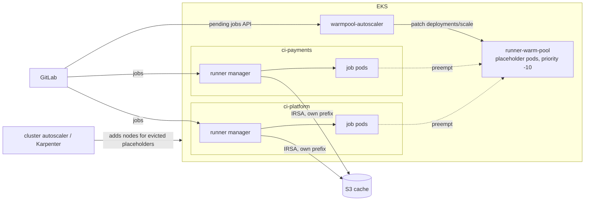

# gitlab-runner-platform

A production-style, multi-tenant GitLab Runner platform on Amazon EKS: Terraform for the fleet, a hardened Helm configuration per tenant, and a small Go service that keeps CI nodes warm based on the live job queue, so jobs start in seconds instead of waiting minutes for a node to boot.

[](https://github.com/sethbergman/gitlab-runner-platform/actions/workflows/ci.yml)

## Why this exists

At scale, the slowest part of a CI job is often not the build. It is the wait for a node. With the Kubernetes executor, a burst of pipelines creates pending pods, the cluster autoscaler adds nodes, and every job in the burst pays for a cold start. Keeping spare nodes around all the time fixes the wait but burns money at night and on weekends.

This platform solves both sides:

- **Queue-aware warm capacity.** `warmpool-autoscaler` reads the pending-job queue from the GitLab API and sizes a pool of low-priority placeholder pods to match. Real job pods preempt placeholders instantly, and the cluster autoscaler backfills behind them.
- **Business-hours schedule.** The pool keeps headroom during working hours and drops to zero overnight.
- **Tenant isolation.** Each team gets its own namespace, runner manager, IAM role, cache prefix, quota and network policy.

The design follows patterns common to enterprise CI platforms: dedicated and tainted CI node pools, one runner manager per team, least-privilege workload identity, preemptible capacity reservation, and SLO-driven operations.

## Architecture



More detail: [docs/architecture.md](docs/architecture.md) · [GitOps](docs/gitops.md) · [autoscaling design](docs/autoscaling.md) · [SLOs](docs/slo.md) · [runbook](docs/runbook.md) · [decision records](docs/decisions/)

## What's in the box

| Path | What it is |
|---|---|
| [`autoscaler/`](autoscaler/) | Go service, standard library only, no third-party dependencies. Policy, GitLab client, Kubernetes scale client, Prometheus metrics; unit-tested, race-checked. |
| [`terraform/modules/runner-fleet/`](terraform/modules/runner-fleet/) | Per-tenant namespaces with Pod Security admission, ResourceQuota, LimitRange and NetworkPolicy (blocks the EC2 metadata endpoint); IRSA roles scoped to a cache prefix; encrypted, TLS-only, auto-expiring S3 cache; one Helm release per tenant with `atomic` upgrades. |
| [`terraform/examples/eks/`](terraform/examples/eks/) | Two tenants on an existing EKS cluster, with short-lived `aws eks get-token` auth and a remote-state stub. |
| [`deploy/autoscaler/`](deploy/autoscaler/) | Kustomize: restricted namespace, PriorityClass, warm pool, least-privilege RBAC (one Deployment's scale, nothing else), network policies, autoscaler Deployment. |
| [`gitops/`](gitops/) | Argo CD app-of-apps: two AppProjects with enforced boundaries, the autoscaler app (ignoring the replica count it owns), and an ApplicationSet with one runner release per tenant. See [docs/gitops.md](docs/gitops.md). |
| [`observability/`](observability/) | Prometheus alert rules with runbook links, and a Grafana dashboard. |
| [`.github/workflows/ci.yml`](.github/workflows/ci.yml) | Go tests with a coverage floor, govulncheck, Terraform fmt and validate, kubeconform, promtool on the rules and on the autoscaler's live `/metrics`, Checkov, image build, and an Argo CD end-to-end test on a kind cluster. |

## Try it locally

No cluster needed. The demo replays a burst of queue depths and shows the policy at work: immediate scale-up, then a held scale-down until the stabilization window passes.

```bash
make demo
```

```text
{"level":"INFO","msg":"resized warm pool","from":0,"to":4,"pending":4,...}
{"level":"INFO","msg":"resized warm pool","from":4,"to":12,"pending":12,...}
{"level":"INFO","msg":"resized warm pool","from":12,"to":30,"pending":30,...}
{"level":"INFO","msg":"resized warm pool","from":30,"to":8,"target":0,...}
```

Metrics are at `http://localhost:8080/metrics` while it runs.

```bash
make test       # go vet + go test -race
make validate   # terraform fmt/validate, kubeconform, promtool (needs the tools installed)
```

## Deploying

1. **Cluster prerequisites.** An EKS cluster with an IAM OIDC provider, a CI node group labeled `workload=ci` and tainted `dedicated=ci:NoSchedule`, the cluster autoscaler or Karpenter, and network policy enforcement turned on (VPC CNI network policy, Calico or Cilium).
2. **Runner tokens.** Create a runner per tenant in GitLab (tags are set there), and sync its `glrt-` token into a Secret named `gitlab-runner-token` in `ci-<tenant>`, with keys `runner-token` and `runner-registration-token` (empty). Use your secret store; tokens never pass through Terraform state.
3. **Fleet.** `cd terraform/examples/eks && cp terraform.tfvars.example terraform.tfvars && terraform init && terraform apply`. To run the runners and autoscaler through Argo CD instead, set `use_gitops = true` and follow [docs/gitops.md](docs/gitops.md).
4. **Autoscaler.** Put a `read_api` token in Secret `warmpool-gitlab-token` (key `token`) in `gitlab-runner-system`, set the projects and tags in `deploy/autoscaler/deployment.yaml`, then `kubectl apply -k deploy/autoscaler`.
5. **Observability.** Load `observability/prometheus-rules.yaml` and import the Grafana dashboard.

## Security posture

- No long-lived AWS keys anywhere. Runner managers use IRSA; job pods get no AWS credentials and cannot reach the instance metadata endpoint.
- Each tenant's IAM role can touch only `s3://<cache>/<tenant>/*`.
- Runner tokens and the GitLab API token live in Kubernetes Secrets synced from a secret store, never in Terraform state or Git.
- The autoscaler runs as non-root on a distroless image with a read-only root filesystem, and its RBAC allows `get` and `patch` on a single Deployment's scale.
- Job namespaces enforce Pod Security `baseline` (no privileged pods) and warn on `restricted`.

## Status and limits

- **Checked on every push:** Go unit tests with the race detector behind a statement-coverage floor, `govulncheck` against the Go vulnerability database, a dry run of the built binary whose `/metrics` page must pass `promtool check metrics`, `terraform validate` on the module and example, schema checks of every manifest including the Argo CD objects under `gitops/`, `promtool` on the alert rules, a Checkov scan (passing, with each skipped check justified inline), and a GitOps test on a kind cluster where Argo CD renders the root app, syncs the autoscaler app and creates one synced runner release per tenant from the ApplicationSet, refuses a tenant app that ships guardrail objects or targets a foreign namespace, then proves autoscaler resizes are not treated as drift while real drift is reverted.
- **Not covered by automated tests:** a live `terraform apply` against AWS, and the tenant runner releases (they need a GitLab instance and runner tokens). The module is written to be applied, but treat the first apply in your account as the integration test.
- **Docker-in-Docker is intentionally not supported**, because it requires privileged pods. Build images with BuildKit rootless or Kaniko instead.

## License

MIT
