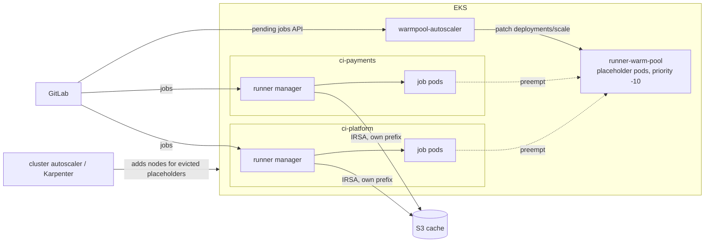

# gitlab-runner-platform

A production-style, multi-tenant GitLab Runner platform on Amazon EKS: Terraform for the fleet, a hardened Helm configuration per tenant, and a small Go service that keeps CI nodes warm based on the live job queue, so jobs start in seconds instead of waiting minutes for a node to boot.

[](https://github.com/sethbergman/gitlab-runner-platform/actions/workflows/ci.yml)

## Why this exists

At scale, the slowest part of a CI job is often not the build. It is the wait for a node. With the Kubernetes executor, a burst of pipelines creates pending pods, the cluster autoscaler adds nodes, and every job in the burst pays for a cold start. Keeping spare nodes around all the time fixes the wait but burns money at night and on weekends.

This platform solves both sides:

- **Queue-aware warm capacity.** `warmpool-autoscaler` reads the pending-job queue from the GitLab API and sizes a pool of low-priority placeholder pods to match. Real job pods preempt placeholders instantly, and the cluster autoscaler backfills behind them.
- **Business-hours schedule.** The pool keeps headroom during working hours and drops to zero overnight.
- **Tenant isolation.** Each team gets its own namespace, runner manager, IAM role, cache prefix, quota and network policy.

The design follows patterns common to enterprise CI platforms: dedicated and tainted CI node pools, one runner manager per team, least-privilege workload identity, preemptible capacity reservation, and SLO-driven operations.

## Architecture



More detail: [docs/architecture.md](docs/architecture.md) · [GitOps](docs/gitops.md) · [autoscaling design](docs/autoscaling.md) · [SLOs](docs/slo.md) · [runbook](docs/runbook.md) · [decision records](docs/decisions/)

## What's in the box

| Path | What it is |
|---|---|
| [`autoscaler/`](autoscaler/) | Go service, standard library only, no third-party dependencies. Policy, GitLab client, Kubernetes scale client, Prometheus metrics; unit-tested, race-checked. |
| [`terraform/modules/runner-fleet/`](terraform/modules/runner-fleet/) | Per-tenant namespaces with Pod Security admission, ResourceQuota, LimitRange and NetworkPolicy (blocks the EC2 metadata endpoint); IRSA roles scoped to a cache prefix; encrypted, TLS-only, auto-expiring S3 cache; one Helm release per tenant with `atomic` upgrades, trusting a private GitLab CA when given one. |
| [`terraform/examples/eks/`](terraform/examples/eks/) | Two tenants on an existing EKS cluster, with short-lived `aws eks get-token` auth and a remote-state stub. |
| [`deploy/autoscaler/`](deploy/autoscaler/) | Kustomize: restricted namespace, PriorityClass, warm pool, least-privilege RBAC (one Deployment's scale, nothing else), network policies, autoscaler Deployment. |
| [`gitops/`](gitops/) | Argo CD app-of-apps: two AppProjects with enforced boundaries, the autoscaler app (ignoring the replica count it owns), and an ApplicationSet with one runner release per tenant. See [docs/gitops.md](docs/gitops.md). |
| [`observability/`](observability/) | Prometheus alert rules with runbook links, and a Grafana dashboard. |
| [`.github/workflows/ci.yml`](.github/workflows/ci.yml) | actionlint with shellcheck on the workflows, Go tests with a coverage floor, govulncheck, Terraform fmt and validate, kubeconform, promtool on the rules and on the autoscaler's live `/metrics`, Checkov, image build, a real Terraform apply and destroy of the module on kind with AWS served by moto, and an Argo CD end-to-end test on a kind cluster. |
| [`.github/workflows/codeql.yml`](.github/workflows/codeql.yml), [`scorecard.yml`](.github/workflows/scorecard.yml) | CodeQL on the Go code and on the workflows, and OpenSSF Scorecard, with results in the Security tab. |

## Try it locally

No cluster needed. The demo replays a burst of queue depths and shows the policy at work: immediate scale-up, then a held scale-down until the stabilization window passes.

```bash
make demo
```

```text
{"level":"INFO","msg":"resized warm pool","from":0,"to":4,"pending":4,...}
{"level":"INFO","msg":"resized warm pool","from":4,"to":12,"pending":12,...}
{"level":"INFO","msg":"resized warm pool","from":12,"to":30,"pending":30,...}
{"level":"INFO","msg":"resized warm pool","from":30,"to":8,"target":0,...}
```

Metrics are at `http://localhost:8080/metrics` while it runs.

```bash
make test       # go vet + go test -race
make validate   # actionlint, terraform fmt/validate and test, kubeconform, promtool (needs the tools and Docker)
```

## Deploying

1. **Cluster prerequisites.** An EKS cluster with an IAM OIDC provider, a CI node group labeled `workload=ci` and tainted `dedicated=ci:NoSchedule`, the cluster autoscaler or Karpenter, and network policy enforcement turned on (VPC CNI network policy, Calico or Cilium).
2. **Runner tokens.** Create a runner per tenant in GitLab (tags are set there) and put its `glrt-` token in your secret store. Have the store sync it into a Secret named `gitlab-runner-token` in each `ci-<tenant>` namespace as soon as the namespace exists, with keys `runner-token` and `runner-registration-token` (empty): for example a ClusterExternalSecret selecting namespaces labeled `platform.ci/tenant`. Terraform creates those namespaces in the next step, so don't create them yourself, and then waits up to 10 minutes for each runner, which cannot start without its token. If a private CA signs GitLab's certificate, sync the CA the same way as `<gitlab host>.crt` and set `gitlab_ca_secret` to that Secret's name. Tokens never pass through Terraform state.
3. **Fleet.** `cd terraform/examples/eks && cp terraform.tfvars.example terraform.tfvars && terraform init && terraform apply`. To run the runners and autoscaler through Argo CD instead, set `use_gitops = true` and follow [docs/gitops.md](docs/gitops.md).
4. **Autoscaler.** Put a `read_api` token in Secret `warmpool-gitlab-token` (key `token`) in `gitlab-runner-system`, set the projects and tags in `deploy/autoscaler/deployment.yaml`, then `kubectl apply -k deploy/autoscaler`. The image is pinned by digest to a [release](https://github.com/sethbergman/gitlab-runner-platform/releases) whose signed build attestation CI verifies before deploying it.
5. **Observability.** Load `observability/prometheus-rules.yaml` and import the Grafana dashboard.

## Security posture

- No long-lived AWS keys anywhere. Runner managers use IRSA; job pods get no AWS credentials and cannot reach the instance metadata endpoint.
- Each tenant's IAM role can touch only `s3://<cache>/<tenant>/*`. The claims in this list are assertions in [the module's tests](terraform/modules/runner-fleet/tests/guardrails.tftest.hcl), run on every push.
- Runner tokens and the GitLab API token live in Kubernetes Secrets synced from a secret store, never in Terraform state or Git.
- The autoscaler runs as non-root on a distroless image with a read-only root filesystem, and its RBAC allows `get` and `patch` on a single Deployment's scale.
- Job namespaces enforce Pod Security `baseline` (no privileged pods) and warn on `restricted`.
- Every `v*` tag publishes the autoscaler image for linux/amd64 and linux/arm64 with a BuildKit SBOM and provenance on the index, a Sigstore-signed build-provenance attestation, and a GitHub Release carrying the digest, created only once every CI job is green. Verify with `gh attestation verify oci://ghcr.io/sethbergman/warmpool-autoscaler:<tag> --owner sethbergman`.

## Status and limits

- **Checked on every push:** actionlint with shellcheck on every workflow, Go unit tests with the race detector behind a statement-coverage floor, `govulncheck` against the Go vulnerability database, CodeQL with the security-extended queries on the Go code and on every workflow, a dry run of the built binary whose `/metrics` page must pass `promtool check metrics`, `terraform validate` on the module and example, `terraform test` with mocked providers proving that each tenant's IAM role reaches only its own cache prefix and is assumable only by its own service account, that every tenant namespace carries the Pod Security, quota and network-policy guardrails, that rendered runner values keep jobs unprivileged with no static credentials, and that the committed tenant values are exactly what the example renders, `helm template` of every tenant with its pinned chart through kubeconform, schema checks of every manifest including the Argo CD objects under `gitops/`, `promtool` on the alert and SLO rules with unit tests that fire every alert, a check that the rules and dashboard name only metrics the binary exports, a Checkov scan (passing, with each skipped check justified inline), a real `terraform apply` of the module on a kind cluster with S3, IAM and STS served by moto, in which every tenant's runner starts and verifies its token over a private CA with a GitLab stand-in, everything read back from AWS and the cluster matches what the module promises, a second plan finds nothing to change and `terraform destroy` empties the cache bucket and leaves nothing behind, and a GitOps test on a kind cluster where Argo CD renders the root app, verifies the signed build attestation of the pinned autoscaler image and then syncs the autoscaler app and runs that image from GHCR, creates one synced runner release per tenant from the ApplicationSet, refuses a tenant app that ships guardrail or cluster-scoped objects or targets a foreign namespace, then proves autoscaler resizes are not treated as drift while real drift is reverted.
- **Protected branch:** `main` takes changes only through pull requests with all eight CI jobs green, keeps linear history and refuses force pushes (a repository ruleset). Vulnerabilities go through [SECURITY.md](SECURITY.md).
- **Checked against a real GitLab:** [`gitlab-e2e.yml`](.github/workflows/gitlab-e2e.yml) boots GitLab CE on a kind cluster's network, over HTTPS so the autoscaler's 443-only egress policy applies as written. It queues one pipeline in each project the autoscaler is configured for and proves the pinned autoscaler image counts those jobs with a `read_api` token and sizes the warm pool for them. Then it installs each tenant's runner from its committed values and pinned chart, and proves every job runs on its own tenant's runner, as a pod in that tenant's namespace, and succeeds. It runs weekly, on demand, and on pull requests that touch the autoscaler manifests or tenant values; `make gitlab-e2e` runs it locally.
- **Checked weekly:** [`upstream.yml`](.github/workflows/upstream.yml) opens a pull request, with CI run on it, when a tool CI installs (actionlint, Argo CD, kubeconform, moto, Prometheus for promtool, Terraform), the GitLab CE image the GitLab e2e boots, or the gitlab-runner chart has a newer release than its pin, since Dependabot sees none of them.
- **Scored:** [`scorecard.yml`](.github/workflows/scorecard.yml) runs OpenSSF Scorecard on every push to `main` and weekly, and files each check scoring below 10 in the Security tab. What remains open there: pull requests need no approval (there is one maintainer), the autoscaler is not fuzzed, there is no OpenSSF best-practices badge, and the repository is under 90 days old.
- **Not covered by automated tests:** real AWS. The Terraform e2e applies the module against moto, which does not enforce IAM and ignores bucket policy conditions, and kind has no OIDC issuer AWS could trust, so IRSA and jobs reading and writing the S3 cache are unproven (the GitLab e2e's jobs use neither). Treat the first apply in your account as that integration test.
- **Docker-in-Docker is intentionally not supported**, because it requires privileged pods. Build images with BuildKit rootless or Kaniko instead.

## License

MIT
